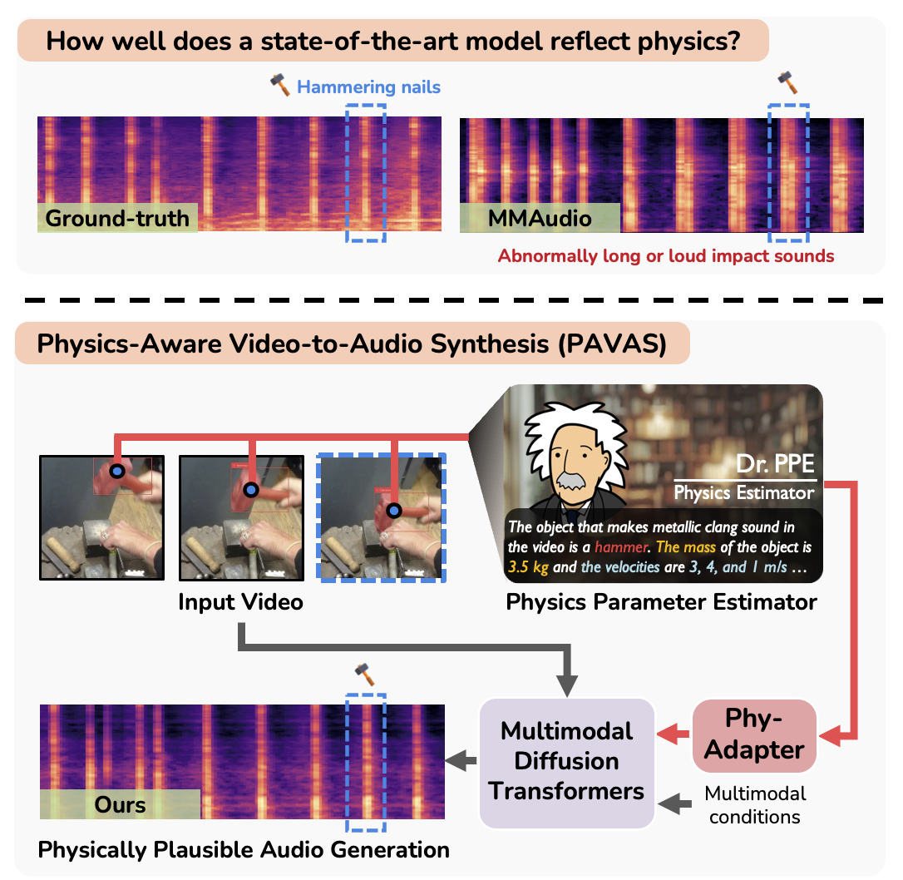

<h1 align="center">PAVAS: Physics-Aware Video-to-Audio Synthesis</h1>

<p align="center"><strong>CVPR 2026 (Oral)</strong></p>

<p align="center">
  Oh Hyun-Bin<sup>1,†</sup>, Yuhta Takida<sup>2</sup>, Toshimitsu Uesaka<sup>2</sup>,
  Tae-Hyun Oh<sup>4</sup>, Yuki Mitsufuji<sup>2,3</sup>
</p>

<p align="center">
  <sup>1</sup>POSTECH &nbsp; <sup>2</sup>Sony AI &nbsp; <sup>3</sup>Sony Group Corporation &nbsp; <sup>4</sup>KAIST
  <br>
  <em><sup>†</sup>Work done during an internship at Sony AI.</em>
</p>

<p align="center">
  <a href="https://physics-aware-video-to-audio-synthesis.github.io/">
    
  </a>
  <a href="https://arxiv.org/abs/2512.08282">
    
  </a>
</p>

<p align="center">
  
</p>

<p align="center">
  PAVAS is a physics-aware video-to-audio synthesis system built on top of MMAudio.<br>
  It augments the generation backbone with object-centric conditioning derived from mass, velocity,
  segmentation, and patch-level visual features so that generated audio better reflects the physical
  interactions in a video.
</p>

## Repository Overview

The repository contains the PAVAS model and training code in [pavas/core](pavas/core),
the independent Physics Parameter Estimator (PPE) and other offline stages in
[precompute](precompute), and the [training](train.py) and
[evaluation](evaluate.py) entrypoints.

PPE is **training-free**: its pretrained estimators extract moving objects,
mass, segmentation, and velocity without training PAVAS. You can use these
outputs in other tasks; see the [standalone PPE guide](precompute/ppe/README.md).

Training and benchmark evaluation use prepared features. For efficient
training, PPE, Phy-Adapter input preparation, and the generator backbone have
not yet been streamlined into a single raw-video inference path. An end-to-end
`generate.py` for arbitrary videos is planned for a later release.

**Only need benchmark scores?** The [VGGSound precomputed results](https://huggingface.co/datasets/HBoh/PAVAS-precomputed-results/tree/main)
let you [evaluate existing caches](#evaluate-precomputed-results) without
training PAVAS or extracting the full training dataset. FoleyBench,
VGGSounder, and FlatSound results are planned for a later release.

## Getting Started

The following steps prepare a VGGSound training run and cache-based evaluation.
Full-dataset VGGSound feature caches, CLIP patch grids, and PPE outputs can
require **tens of terabytes** of storage. These intermediate features are not
distributed here; prepare sufficient storage and extract them locally. If you
only want to evaluate the released results, skip to
[Evaluate Precomputed Results](#evaluate-precomputed-results).

### 1. Install and Check the Environment

From the repository root, use Python 3.10+ on a machine with an NVIDIA GPU:

```bash
bash scripts/setup_env.sh
source .venv/bin/activate
bash scripts/run_smoke_tests.sh
```

The smoke tests check imports and data contracts, not full GPU inference.
See [INSTALL.md](INSTALL.md) for manual installation and FFmpeg requirements.

### 2. Prepare VGGSound and External Weights

Download VGGSound and arrange videos as `/path/to/vggsound/video/<id>.mp4`,
where `<id>` comes from `sets/vgg-{train,val,test}.tsv`. The videos and their
audio are needed to produce the feature caches; the dataset is not bundled.

Place the VAE, vocoder, empty-string embedding, and Synchformer assets in
`ext_weights/` using the [required filenames](INSTALL.md#step-5-prepare-external-weights).
Download an [MMAudio model checkpoint](https://github.com/hkchengrex/MMAudio/blob/main/docs/MODELS.md)
separately for PAVAS training initialization. The visual encoders download
their pretrained weights on first use: DFN5B-CLIP for MMAudio visual features
and LAION CLIP ViT-B/16 for PAVAS patch features. Ensure the Hugging Face
cache is accessible. [INSTALL.md](INSTALL.md) lists the exact weights and paths.

### 3. Extract VGGSound Feature Caches

Follow [MMAudio's training guide](https://github.com/hkchengrex/MMAudio/blob/main/docs/TRAINING.md)
to extract the audio/video/text feature caches for train, val, and test.
PAVAS expects each split's `vgg-<split>.tsv` and matching `vgg-<split>/`
memmap directory. These are **VGGSound feature caches**, not the
`av-benchmark` ground-truth audio cache used for metrics. See the
[cache notes](precompute/mmaudio_cache/README.md) for the PAVAS-side layout.

### 4. Extract CLIP Patch Features

Run the extractor once for each split:

```bash
for split in train val test; do
  python precompute/clip_patches/extract_clip_patches_mp.py \
    --video_root /path/to/vggsound/video \
    --tsv "sets/vgg-${split}.tsv" \
    --output_dir "/path/to/clip_patches/${split}" \
    --clip_model vit_b_16 --clip_size 224 \
    --batch_size 8 --num_workers 8
done
```

Each split produces `vgg-patches.tsv` and `vgg-patches/clip_patches.npy`.
Use the **generated TSV and NPY from the same run** in the config, not the
input `sets/vgg-*.tsv`. Patch grids are especially storage-intensive; see the
[CLIP patch guide](precompute/clip_patches/README.md) before a full run.

### 5. Extract PPE Outputs

Download the public pretrained PPE assets, then try one video before
processing the entire dataset:

```bash
python precompute/ppe/scripts/download_ppe_assets.py
python precompute/ppe/scripts/run_ppe_pipeline.py \
  --tsv sets/vgg-train.tsv \
  --video-root /path/to/vggsound/video \
  --output-root /path/to/ppe --limit 1
```

Inspect the summary under `/path/to/ppe/work/`, then rerun without `--limit`
for the full train split. Repeat with `sets/vgg-val.tsv` and
`sets/vgg-test.tsv` for the other splits. Outputs are written to
`/path/to/ppe/{mass,segmentation,velocity}/`; `work/` holds intermediate
files. For multiple GPUs, run **every** shard index from `0` to `N-1`, one
process per GPU. The runner can resume completed outputs. See the
[PPE guide](precompute/ppe/README.md) for sharding, retries, and standalone
use on a different collection of videos.

### 6. Point the Configs to Your Outputs

Set these paths for `ExtractedVGG`, `ExtractedVGG_val`, and
`ExtractedVGG_test` in [configs/data/base.yaml](configs/data/base.yaml):

| Config key in each split | Expected output |
| --- | --- |
| `tsv`, `memmap_dir` | VGGSound feature-cache TSV and matching memmap directory |
| `clip_patches.tsv`, `clip_patches.npy` | Generated CLIP patch index and NPY from the same run |
| `object_cond.mass_root`, `seg_root`, `velocity_root` | PPE `mass/`, `segmentation/`, `velocity/` directories |
| `gt_cache` (val/test) | Separate `av-benchmark` VGGSound ground-truth audio cache |

For the GT cache, follow [MMAudio's evaluation guide](https://github.com/hkchengrex/MMAudio/blob/main/docs/EVAL.md).
Check external-weight paths in [configs/base_config.yaml](configs/base_config.yaml)
and the model variant in the [training](configs/train/finetune.yaml) and
[evaluation](configs/eval/eval.yaml) configs. `configs/paths.example.yaml` is
a worksheet, **not** an active Hydra config.

### 7. Train PAVAS

This single-GPU example uses the MMAudio checkpoint only to initialize
training:

```bash
source .venv/bin/activate
OMP_NUM_THREADS=4 torchrun --standalone --nproc_per_node=1 \
  train.py exp_id=pavas_finetune model=small_16k batch_size=4 \
  weights=/path/to/mmaudio_small_16k.pth
```

The configured **global** batch size is 512; this example overrides it to
fit one GPU. Match `model=` to the checkpoint variant. Training writes
`<exp_id>_last.pth` for evaluation and `<exp_id>_ckpt_last.pth` for resuming
training in its output directory. See [Training](docs/training.md).

## Evaluate Your Trained Model

Use the PAVAS weights produced by your own training run and the prepared test
features and GT cache:

```bash
source .venv/bin/activate
python scripts/download_eval_assets.py
OMP_NUM_THREADS=4 torchrun --standalone --nproc_per_node=1 \
  evaluate.py model=small_16k \
  +test.weight_path=/path/to/pavas_finetune_last.pth
```

`evaluate.py` generates audio, extracts its prediction cache, and computes
metrics with `av-benchmark` in the same run. Do not run a separate metric step
afterward. The model variant must match your trained weights. See
[Evaluation](docs/evaluation.md).

## Evaluate Precomputed Results

The [VGGSound prediction cache on Hugging Face](https://huggingface.co/datasets/HBoh/PAVAS-precomputed-results/tree/main)
provides a shorter route to the metrics: download and extract its cache,
prepare the matching VGGSound test GT cache using the
[MMAudio evaluation guide](https://github.com/hkchengrex/MMAudio/blob/main/docs/EVAL.md),
and run:

```bash
source .venv/bin/activate
python scripts/download_eval_assets.py
python scripts/evaluate_precomputed.py \
  --gt-cache /path/to/vggsound_eval_cache \
  --pred-cache /path/to/PAVAS_large_vggsound_cache
```

This computes metrics from existing caches without generating audio or
repeating prediction feature extraction. Install and asset details are in
[INSTALL.md](INSTALL.md); cache format and options are in
[Evaluation](docs/evaluation.md). FoleyBench, VGGSounder, and FlatSound
results will be added later.

## Documentation

- [INSTALL.md](INSTALL.md)
- [docs/architecture.md](docs/architecture.md)
- [docs/training.md](docs/training.md)
- [docs/evaluation.md](docs/evaluation.md)
- [precompute/README.md](precompute/README.md)

## Acknowledgements

This project makes use of the following open-source repositories and modules:

- [MMAudio](https://github.com/hkchengrex/MMAudio)
- [av-benchmark](https://github.com/hkchengrex/av-benchmark)
- [Qwen2.5-VL](https://github.com/QwenLM/Qwen2.5-VL)
- [Grounded-SAM-2](https://github.com/IDEA-Research/Grounded-SAM-2)
- [CUT3R](https://github.com/CUT3R/CUT3R)

Copies of third-party license and notice files used in this repository are
collected under [third_party_licenses/](third_party_licenses).

## Related Projects

If you are also interested in a more versatile and actively updated Sony video(+text)-to-audio line of work, we recommend checking out [Woosh](https://github.com/SonyResearch/Woosh).

## Citation

If you find this repository or research useful, please cite both PAVAS and MMAudio.

```bibtex
@inproceedings{hyun2026pavas,
  title={PAVAS: Physics-Aware Video-to-Audio Synthesis},
  author={Hyun-Bin, Oh and Takida, Yuhta and Uesaka, Toshimitsu and Oh, Tae-Hyun and Mitsufuji, Yuki},
  booktitle={CVPR},
  year={2026}
}

@inproceedings{cheng2025taming,
  title={{MMAudio}: Taming Multimodal Joint Training for High-Quality Video-to-Audio Synthesis},
  author={Cheng, Ho Kei and Ishii, Masato and Hayakawa, Akio and Shibuya, Takashi and Schwing, Alexander and Mitsufuji, Yuki},
  booktitle={CVPR},
  year={2025}
}
```

## Contact

hyunbinoh@postech.ac.kr or hyunbin70@gmail.com
